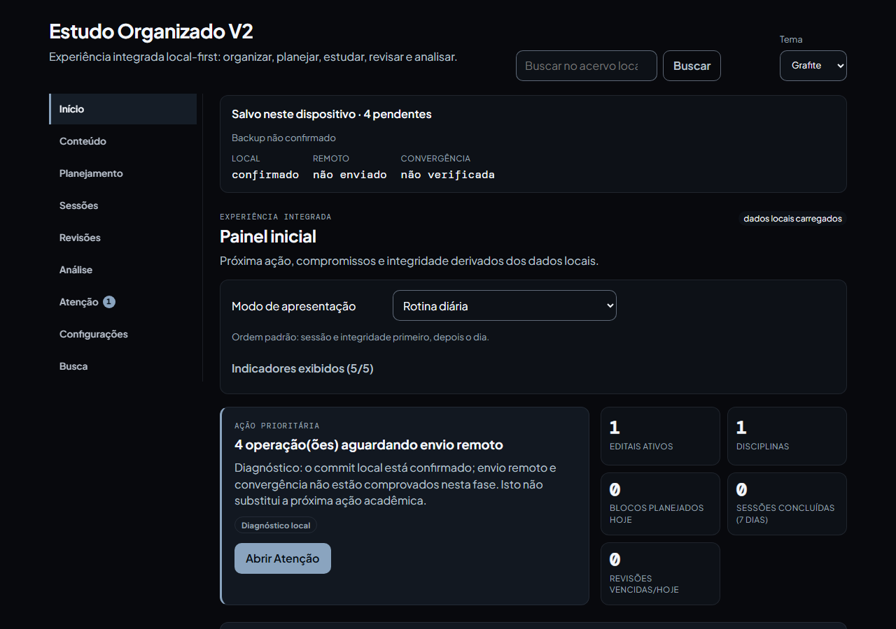
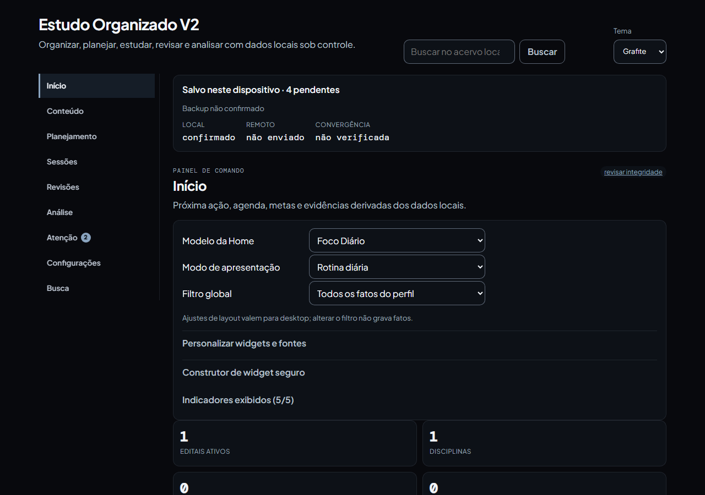
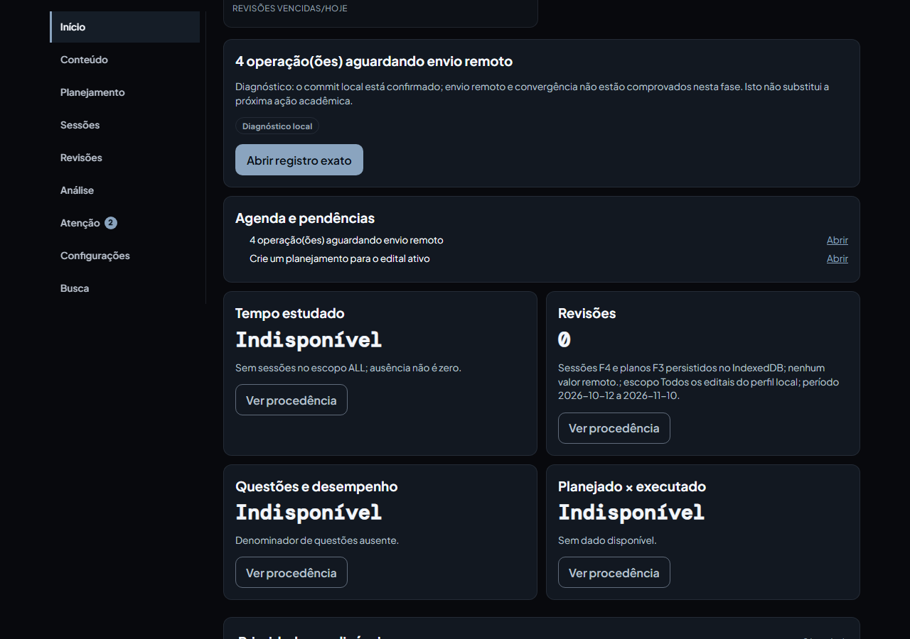
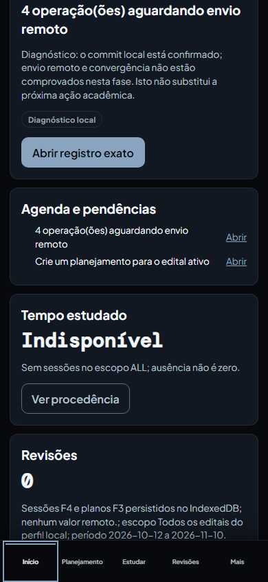

# F7-UX — resumo da implementação local

**Data:** 10/11/2026

**Checkout:** `C:\Projetos\estudo-organizado\_v2-candidate`

**Baseline de entrada:** `3145e95440f0c38178a205f4247b67a180564214` (`v2`)

**Estado pretendido:** `F7_UX_LOCAL_IMPLEMENTED_TESTED_FOR_REVIEW`

**Não é:** aceite humano, homologação G-EXT/G-STAGING, publicação de staging, merge na `main` ou F8.

## O que foi entregue

A experiência F7-UX foi evoluída sobre o código F2–F7 existente, sem substituir Auth, sync, outbox, IndexedDB, backup, restore ou regras de domínio. O trabalho adiciona:

- contratos de evidência que mantêm separados commit local, outbox, ACK, convergência, leitura parcial, prévia de backup e restauração;
- correção da semântica de bloco cumprido: somente conciliação explícita `CONCLUDED` retira um bloco da fila de atraso;
- rotas com ID exato e recusa de entidade inexistente/de outro perfil;
- navegação desktop com sidebar, tablet com rail e celular com `Início · Planejamento · Estudar · Revisões · Mais`;
- ação `Estudar` contextual que abre opções, sem iniciar cronômetro;
- Home com modelos `Foco Diário`, `Desempenho`, `Reta Final` e `Personalizado`, widgets responsivos, filtros global/local/grupo, inspetor de procedência e construtor de fórmula controlada;
- Central de Atenção deduplicada por identidade causal, com badge compartilhado e dispensa apenas de apresentação;
- busca completa agrupada por tipo, mantendo a mesma consulta local da busca rápida;
- workspace de Conteúdo com reordenação por botões e drag-and-drop, além de movimentação de hierarquia validada;
- Análises com metodologia, numerador/denominador, snapshots imutáveis, editor de séries, gráfico de barras/linha e tabela equivalente;
- Configurações separadas em aparência, perfil, backup, armazenamento e privacidade, com diagnóstico redigido e leitura de `navigator.storage`;
- diálogo modal acessível para confirmação de restauração/rebaseline, com foco inicial e retorno ao gatilho;
- remoção de `var(--text-primary)` inexistente, correção do fingerprint de analytics e dos estados “ausente ≠ zero”.
- restauração F7 fail-closed: `REBASELINE_REQUIRED` nunca escreve, uma mudança concorrente após a prévia retorna `STALE`, a base atual é exportada antes do commit e cada linha gravada é conferida por read-back na mesma transação.
- arquivos F1/F2 são classificados com a época real do perfil apenas para prévia; não são importados como se fossem um backup F7 integral.

## Antes e depois

| Antes | Depois |
|---|---|
|  |  |
|  |  |

A pasta `evidence/baseline/` contém a captura anterior à mudança: 31 imagens F6 em oito temas e três viewports. `evidence/after/` contém módulos em desktop/tablet/mobile/320 px e a matriz final dos oito temas, geradas por `tests/e2e/f7-ux-evidence.spec.ts` com fixtures sintéticas.

## Decisões preservadas

- D01–D71 e UX-01–UX-31 não foram renumeradas.
- Oito temas, Plus Jakarta Sans e DM Mono foram preservados.
- Home, Busca, Atenção e Análises continuam projeções somente leitura.
- Nenhum segundo store, outbox, scheduler, formato de backup ou motor de planejamento foi criado.
- `overview` permanece acessível.
- Nenhum serviço real, custo, Action, PR, deploy, push ou alteração de `main` foi executado.

## Limites explícitos

Firebase/Auth/Firestore/Cloudflare/KV reais, multi-dispositivo físico, cotas reais, HTTPS/staging, hardware modesto, NVDA/Narrator e migração V1 real continuam `NOT_RUN` ou bloqueados pelos gates externos. A validação E2E usa fake remote determinístico, IndexedDB, Web Locks e BroadcastChannel reais apenas no navegador local.

As preferências visuais e snapshots de relatório ficam no armazenamento local deste navegador, fora das stores canônicas coletadas pelo backup F7. A UI informa que são artefatos locais; não foram declarados sincronizados ou recuperáveis pelo backup operacional. A chave de recuperação continua vinculada à sessão do runtime F7 e precisa ser configurada novamente após fechar a aba.

## Rodada 2026-11-10 — aderência UX-16 a UX-21

Classificação final desta rodada: **F7_UX_ADHERENCE_PARTIAL_WITH_EXACT_GAPS**. A matriz anterior marcava UX-16 a UX-21 como PASS_LOCAL; a auditoria dirigida mostrou que quatro delas tinham lacunas materiais e duas eram apenas parciais.

Correções verificadas:

- encaixe de revisão recusa sobreposição, horário inválido e travessia de meia-noite, e faz prévia sem gravar bloco;
- pausa/conclusão de sessão não creditam lacuna não observada; conclusão incerta vai para recuperação;
- correção manual fecha o episódio de recuperação em vez de somar o mesmo tempo a cada clique;
- alocação valida sessionId e a UI bloqueia disciplina arquivada/assunto removido;
- Pomodoro usa continuidade real em vez de forçar VALID;
- ativação de cenário exige prévia explícita, usa baseRevision e preserva snapshot restaurável do checkpoint;
- calendário ganhou modo lista com blocos sem data/horário e conflitos;
- fila de revisões ganhou filtros por situação, edital, disciplina e ordenação por prioridade;
- fatores de prioridade passaram a exibir rótulo e explicação;
- Home em 320 px foi corrigida: próxima ação em y=183 e nenhum overflow com texto a 200%.

Provas novas: f7-ux-review-placement.test.ts (4), f7-ux-session-integrity.test.ts (4), f7-ux-planning-activation.test.ts (2), f7-ux-planning-workspace.spec.ts (2), f7-ux-reviews-queue.spec.ts (2) e f7-ux-home-320.spec.ts (1). Detalhes por requisito em UX16-UX21-TRACEABILITY.md.

Lacunas mantidas: disponibilidade semanal/exceções editáveis (P1), estado “revisão iniciada” (P1), diff da política base, histórico de compromissos/conflito de importação, inspetor de histórico de sessão e mês civil no calendário (P2). Nenhuma foi mascarada como PASS.
